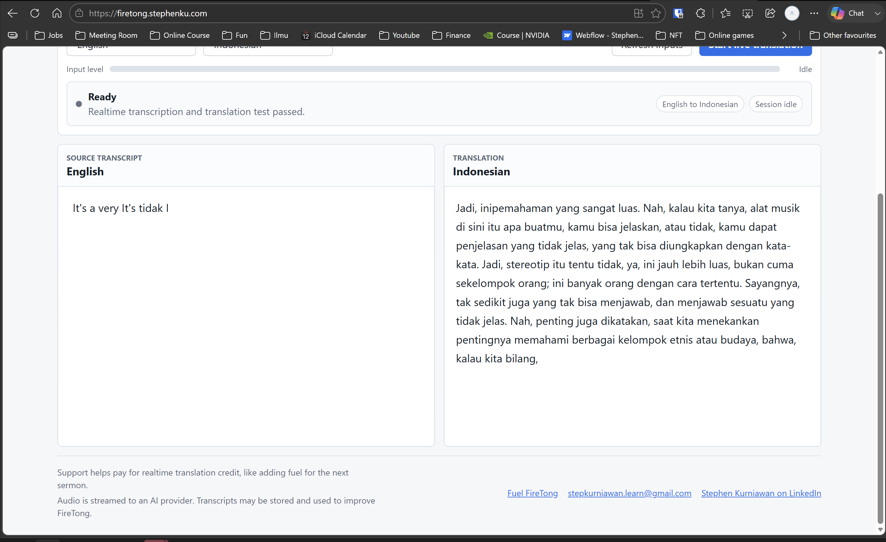
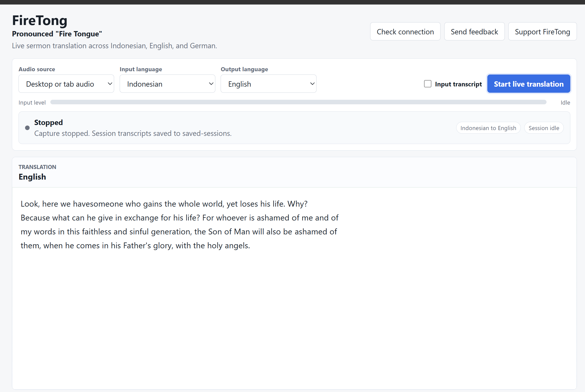

# Disabling Transcript by Default
## 5 June 2026
Today I tested the app in a non-optimal condition. Not only that the mic was set so far away from the speaker (I was using laptop mic from behind), but also there was a live translator today (preacher in English, translator in Indo).
What happened was : . The transcript was so bad that it didn't hear anything. The translation was surprisingly ok. I decided to disable the transcription by default and people can enable it when they want. 

